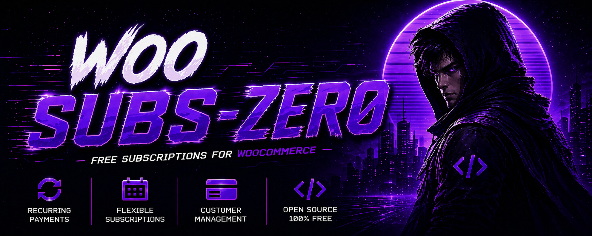

# Woo Subs-Zero - Free Subscriptions for WooCommerce

> [!IMPORTANT]
> **Open Source Beta**
> This plugin is open source and currently in beta.
> Use it in staging first, validate renewal flows with your gateway, and review logs/operations before production rollout.

## Table of Contents

- [Why Woo Subs-Zero](#why-woo-subs-zero)
- [Feature Highlights](docs/sections/feature-highlights.md)
- [Beta Status](#beta-status)
- [Requirements](docs/sections/requirements.md)
- [Installation](docs/sections/installation.md)
- [Quick Start](#quick-start)
- [Usage Guide](docs/sections/usage-guide.md)
- [Operations](#operations)
- [Testing and Quality Checks](#testing-and-quality-checks)
- [Technical Identifiers](#technical-identifiers)
- [Documentation Index](#documentation-index)
- [Agents and Skills](#agents-and-skills)
- [Open Source](docs/sections/open-source.md)
- [Security](#security)
- [License](#license)

## Why Woo Subs-Zero

- It's free.
- Works without requiring the WooCommerce Subscriptions extension.
- Uses deterministic scheduling and idempotency safeguards for renewal correctness.
- Keeps gateway credentials in WooCommerce Payments settings (no duplicate gateway credential screens).

## Feature Highlights

Includes lifecycle/state management, renewal scheduling, retries, switching, synchronization, customer actions, QA tooling, and webhook hardening.

Read more: [Feature Highlights](docs/sections/feature-highlights.md)

## Beta Status

Woo Subs-Zero is currently in beta.

- Features are functional but still evolving.
- Edge-case behavior can change between beta releases.
- Production stores should validate full checkout, renewal, retry, and webhook flows before launch.

## Requirements

Requires modern WordPress, WooCommerce, and PHP versions, with tokenized gateways recommended for full parity behavior.

Read more: [Requirements](docs/sections/requirements.md)

## Installation

Supports source installation and ZIP upload workflows, with optional recurring charge provider integration.

Read more: [Installation](docs/sections/installation.md)

## Quick Start

1. Configure payment gateways in WooCommerce > Settings > Payments.
2. Configure subscription behavior in WooCommerce > WSZ Subscriptions.
3. Create a WSZ subscription product (simple or variable).
4. Place a checkout order with a subscription item.
5. Verify activation and queued renewals in subscription admin screens.

## Payment Gateway Compatibility

Woo Subs-Zero can store WooCommerce payment context, but automatic renewals are safest only with gateways that provide a reusable token and a tested server-side recurring charge path.

| Gateway | Compatibility | Notes |
| --- | --- | --- |
| WSZ Test Card | Recommended for QA/staging | Built into this plugin. Use it to validate subscription lifecycle, renewal scheduling, retries, and transaction logging without charging real cards. |
| PAY.nl card gateways (`pay_gateway_visamastercard`, `pay_gateway_visa`, `pay_gateway_mastercard`, and `pay_gateway_creditcardsgrouped`) | Requires PAY.nl setup and verified callback staging | Requires PAY.nl Card-not-present Visa/Mastercard, Tokenization, Create token on transaction, recurring/MIT permission for Card Payment authorize token requests, API credentials (`AT-code:API token`), and the correct Sales Location ID. Automatic setup waits for an authenticated callback and valid saved `recurring_id` belonging to the same customer and gateway. Unsigned token callbacks are rejected unless an explicitly trusted verifier is supplied. See [card callback requirements](docs/paynl-sepa.md#paynl-card-callbacks). Additional card IDs require explicit registration through `wsz_subs_paynl_gateway_ids`; the provider prefix does not establish recurring support. |
| PAY.nl iDEAL signup → SEPA bank renewals | Implemented, opt-in; requires merchant setup and staging acceptance | Enable PAY.nl SEPA separately after PAY.nl approves Direct Debit. EUR only; requires fresh explicit mandate consent, creditor details and bank details at checkout. WSZ uses each renewal order total and the subscription schedule. See [PAY.nl SEPA setup and recovery](docs/paynl-sepa.md). Existing iDEAL subscriptions are not automatically enrolled. |
| Other unsupported PAY.nl methods (including `pay_gateway_incasso`) / iDEAL without SEPA authorization | Manual subscription renewals only | New unsupported purchases require **Enable manual renewals**. Existing subscriptions fall back to manual payment; a paid initial bank transaction alone is not reusable authorization. |
| Manual/offline gateways | Supported as manual renewals | Safe for order/subscription tracking, but renewals require manual payment collection. They should not be treated as automatic card renewals. |
| Stripe (`stripe`) | Supported after Stripe setup | Enable Stripe tokens in WSZ Payment Gateways. Renewals use the saved Stripe customer and payment method to create confirmed off-session PaymentIntents with idempotency. |
| Mollie Credit Card (`mollie_wc_gateway_creditcard`) | Supported after Mollie recurring setup | Enable Mollie tokens in WSZ Payment Gateways. Renewals use the saved Mollie customer and mandate context to create customer payments with `sequenceType=recurring`. |
| PayPal Payments | Not certified for automatic WSZ renewals yet | PayPal automatic renewals require either PayPal Subscriptions or Vaulting/Reference Transactions. Those are gateway-specific flows. WSZ does not currently include a PayPal vault/reference-transaction adapter. |
| Adyen | Not certified for automatic WSZ renewals yet | Adyen supports tokenized subscription payments, but requires stored payment method IDs, shopper references, recurring processing model, credential roles, and webhooks. WSZ does not currently include an Adyen-specific adapter. |
| Other tokenized gateways | Requires custom validation | Gateways can be registered through the `wsz_subs_tokenized_gateway_ids` filter, but each gateway needs a tested recurring-charge implementation and webhook/transaction-ID behavior before production use. |

For production automatic card renewals, validate a full cycle in staging: initial checkout, token exchange, renewal charge, exchange webhook, WooCommerce renewal order transaction ID, and the subscription Card Transactions row.

PAY.nl card [recurring payments](https://developer.pay.nl/docs/recurring-payments) use a card token; bank [direct-debit mandates](https://developer.pay.nl/docs/direct-debit-mandates) are a separate integration, available as an opt-in feature from 0.1.56. For subscriptions affected by the iDEAL misclassification in 0.1.54, follow the [recovery procedure](docs/operations-playbook.md#paynl-ideal-subscriptions-created-before-0155).

## Usage Guide

Covers product setup, finite-term behavior, renewal/retry flow, webhook verification contract, and built-in QA tooling.

Read more: [Usage Guide](docs/sections/usage-guide.md)

## Operations

See the operations playbook for queue and incident workflows:

- [docs/operations-playbook.md](docs/operations-playbook.md)

Useful queue command:

- `wp action-scheduler run --group=wsz-subscriptions --batch-size=200`

## Testing and Quality Checks

Run PHPUnit:

- `./vendor/bin/phpunit -c phpunit.xml.dist`

Run the PAY.nl Checkout Block regressions (Node.js built-in test runner; no npm dependencies):

- `node --test tests/checkout/paynl-block-checkout.test.js`

Run syntax checks:

- `rg --files -g '*.php' | xargs -I{} php -l "{}"`

## Technical Identifiers

- Plugin bootstrap file: `wsz-woo-subscriptions.php`
- Text domain: `woo-subzero`
- Action Scheduler group: `wsz-subscriptions`

## Documentation Index

- [docs/README.md](docs/README.md): central documentation table of contents.
- [docs/operations-playbook.md](docs/operations-playbook.md): queue operations, backlog recovery, and incident runbook.
- [docs/sections/README.md](docs/sections/README.md): section-by-section documentation index.
- [CHANGELOG.md](CHANGELOG.md): release history.
- [SECURITY.md](SECURITY.md): security reporting and policy.

## Agents and Skills

This repository includes project-scoped agent and skill assets for implementation workflows, regression safety, and release-readiness checks.

Read more: [Agents and Skills](docs/sections/agents-and-skills.md)

## Open Source

Woo Subs-Zero is open source and welcomes contributions and issue reports.

Read more: [Open Source](docs/sections/open-source.md)

## Security

- Security policy and reporting process: [SECURITY.md](SECURITY.md)

## License

This repository is licensed under GPL-2.0-or-later.

See [LICENSE](LICENSE).
